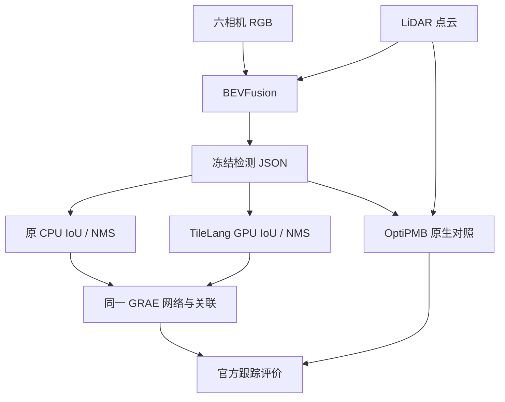

# 已验证的保留方案与优化成果

算法源文件、运行入口及候选采用状态集中见[算法实现索引](ALGORITHM_INDEX.md)。

更新日期：2026-10-14。证据快照：[73efc89](https://github.com/pyk142857/CARperception/blob/73efc89338062ed24ff8cb3211e143c4d4354560/README.md)。

本项目保留已验证的模型部署方案、跟踪策略和算子实现，并区分“功能已完成”“精度改善”“稳定提速”与“完整验收通过”。本次整理说明文档和简历口径；运行配置、默认后端和历史回放的切换状态仍以对应实验记录为准。原始对照、退化结果和候选代码保留，便于复核。

## 项目设计与演进

目标是用真实模型和公开数据完整走通感知工程流程：读取六相机图像、LiDAR点云、标定/位姿/时间戳，完成坐标适配与推理，输出可评价的检测、轨迹和语义结果，再通过官方评价、失败事件复核和配对实验选择优化方案。各任务按模块部署，核心网络使用开源预训练权重。

| 阶段 | 实际设计与工作 | 保留结果 |
|---|---|---|
| 2026-09-22至24：基础感知与评价 | YOLOv8s、SegFormer、深度模型、PointPillars、CenterPoint/PubTracker；后续补充Cylinder3D和MapTR，核对坐标与同步回放 | 39帧教学闭环、COCO5000评价、官方nuScenes检测评价；图像分割/深度仍按各自实际运行范围记录 |
| 2026-09-30：失败驱动的关联优化 | 固定CenterPoint检测，对比全局匹配、运动估计、尺寸/运动代价及置信度两阶段策略；再剖析CPU复制和关联热点 | S4_greedy_low身份稳定性改善；FastCandidateTracker输出等价且CPU函数提速3.77倍 |
| 2026-10-08至12：融合与推理部署扩展 | 部署BEVFusion、TensorRT FP16、Sparse4D和GaussianWorld，补查几何/张量及重复一致性 | BEVFusion原生融合检测；FP16与pooling失败证据独立保存；占用未计算缺失GT的IoU |
| 2026-10-13：新模型与整网对照 | DEIMv2三后端、MambaFusion→GRAE及HARP-NeXt真实权重运行和评价 | DEIMv2原生AP改善；其余按精度、身份稳定性和一致性分别决定保留 |
| 2026-10-14：固定检测与GPU热点优化 | 固定BEVFusion输入比较GRAE/OptiPMB；TileLang几何/NMS、KernelBench任务适配、完整GRAE计时；pooling返回整网复测 | GPU GRAE39/81帧分别5.76/8.51倍，输出及官方指标一致；OptiPMB和pooling未采用 |

当前三条主要实测链路分别为：相机→DEIMv2二维检测、LiDAR→CenterPoint→两阶段/FastCandidateTracker、六相机+LiDAR→BEVFusion→GRAE。Cylinder3D点云语义分割和MapTR矢量地图是并行功能；共享数据与回放，不将其表述为已验证的联合网络或统一实时流水线。

本轮冻结检测与GPU对照的关系如下。GRAE的网络/关联保持相同，CPU参考和GPU候选分别运行：

OptiPMB额外使用真实点云统计，原生配置/预处理也不同，因此算法间精度比较属于系统比较。GPU收益来自同一GRAE的CPU/GPU配对；计时从冻结JSON读取到可消费轨迹，包含搬运，排除BEVFusion前向和GT评价。GT仅进入后续评价/展示。

闭环的实际做法是固定输入和配置、保存基线预测，使用官方评价与独立阈值诊断发现失败，再做策略/热点修改，复核输出和完整流程计时，依据证据决定保留；教学身份统计与官方IDS分开记录。

## 优先保留的优化成果

| 方案 | 采用理由 | 已验证范围 | 实现与证据 |
|---|---|---|---|
| TileLang FP64三维IoU／NMS预处理 | 固定BEVFusion→GRAE：39帧142.81→24.77ms/帧、5.76倍；81帧263.80→31.00ms/帧、8.51倍；120帧轨迹逐字节一致、全部官方指标一致 | RTX4090；两组完整序列各30轮AB/BA，均30/30更快且P95下降；包括JSON/预处理/搬运/原生GRAE，排除BEVFusion前向 | [实测报告](reports/tracking_gpu_20261013/report.md)、[每轮原始数据](reports/tracking_gpu_20261013/paired_benchmark.json)、[实现](tools/tracking_gpu_kernel_20261013.py) |
| DEIMv2-S 原生 FP32 二维检测 | COCO AP 44.95%→50.86%，提高5.91个百分点；替代 YOLOv8s 作为优先二维检测方案 | 同一 COCO val2017 5,000图、官方 pycocotools COCOeval；mini 39帧六相机234图只作展示 | [DEIM报告](reports/perception_2025_20261013/deimv2/report.md)、[历史YOLO指标](results/metrics.csv)、[实现](tools/deimv2_2025.py) |
| S4_greedy_low 两阶段贪心关联 | 固定 CenterPoint 检测，全类连续 ID 切换46→38、行人42→36，FP579/FN39不变；连续及中断后身份错误合计84→75 | scene-0061，39帧，score≥0.25、同类XY距离<2m的教学诊断；13组配置对照并复跑 | [实验报告](reports/tracking_optimization/report.md)、[配置](reports/tracking_optimization/configs.json)、[参考实现](tools/experimental_tracker.py) |
| FastCandidateTracker CPU关联算子优化 | 相对同一 S4_greedy_low 参考实现，2.910→0.772 ms/帧，3.77倍；全部输出字段、顺序、ID、诊断精确一致 | i9-14900KF；39帧、4,547个输入框；预热后30轮交替顺序配对，每实现1,170个计时样本；72项测试 | [性能报告](reports/tracking_operator_optimization/report.md)、[原始摘要](reports/tracking_operator_optimization/summary.json)、[实现](tools/fast_candidate_tracker.py) |

DEIM对比是不同模型和预训练权重的部署方案对比，不是同一模型训练消融。S4_greedy_low 的身份统计不是官方 IDS/AMOTA，策略收益尚限于当前单场景；历史默认回放仍保存作者基线。3.77倍只覆盖 CPU 跟踪函数中的复制、关联和诊断，排除感知网络、坐标变换、文件读写及渲染。

两阶段策略固定max_age=3：score≥0.5先关联，较低分框随后续接；新轨迹阈值0.25，行人关联门限1m，其余类别门限按参考实现保留。完整候选名S4_greedy_low表示“贪心关联＋置信度两阶段＋较低新建阈值0.25”，不是新增检测网络。

CPU实现保留六项改动：输入复制快路径、批量坐标与速度回推、类别编码广播、分别计算dx/dy的二维距离矩阵、两阶段代价矩阵复用、诊断筛选向量化。保留float32转换位置、相等代价下的选择次序及输入/输出隔离。

## 保留的原生功能与基线

| 任务 | 保留实现 | 实测结果与用途 |
|---|---|---|
| Camera-LiDAR融合检测 | BEVFusion R50 / PyTorch FP32，上游BEV pooling | 39帧 mAP71.18%/NDS62.23%；81帧 mAP57.90%/NDS51.45%；[官方评价与复现](reports/deployment_4090_20261008/bevfusion_reference/report.md) |
| 学习型三维跟踪 | BEVFusion固定检测→GRAE-3DMOT，原生关联与导出 | 39帧AMOTA86.26%、IDS5；81帧AMOTA82.30%、IDS13；是已运行的独立链路，不宣称相对其他跟踪器的单模块增益；[报告](reports/perception_2025_20261013/grae3dmot/report.md)、[输入来源](reports/perception_2025_20261013/grae3dmot/frozen_reference/input_manifest.json) |
| 点云语义分割 | Cylinder3D 原生实现 | 同一39帧、1,016,188有效点、16个非零并集类别，mIoU71.99%，高于HARP-NeXt的64.42%；保留原始点映射与GT对照；[摘要](reports/published_results/lidarseg_summary.json)、[复现](LIDARSEG.md) |
| 三维检测教学与策略输入 | CenterPoint | 保留39帧检测、官方检测评价，以及已验证的两阶段CPU跟踪输入；[官方评估](reports/official_detection_mini/report.md) |
| 矢量地图和同步排障 | MapTR、Rerun失败案例工作台 | 保留39帧地图展示、六相机/BEV/3D定位与事件复核；地图展示不等于地图精度改善；[MapTR](MAPTR.md)、[工作台](reports/failure_events/report.md) |

以上是独立实测链路：CenterPoint→S4/FastCandidateTracker 与 BEVFusion→GRAE 分开记录。当前没有 BEVFusion→FastCandidateTracker 的同口径实测结果，不能直接拼接后沿用旧指标。相机二维检测、点云分割和矢量地图是并行功能，不作为已验证的跨任务联合模型。

## 可选后端与尚未采用的候选

| 候选 | 决定 | 理由与证据 |
|---|---|---|
| DEIMv2 TensorRT 10.6 FP16 | 保留可选加速后端；原生仍为默认 | 三张暖缓存图、batch1、30轮交错配对，端到端16.665→7.526ms，2.21倍，30/30更快；完整COCO5000 AP **50.861%→50.807%**，下降0.0541个百分点，满足预算；置信度跨阈值变化仍存在，严格候选一致性未通过。简历可表述为后端部署与限定范围实测，不能表述为完整验收或默认采用；[报告](reports/perception_2025_20261013/deimv2/report.md) |
| DEIMv2 ONNX Runtime FP32 | 保留导出/正确性后端 | AP近似一致，但配对端到端17.238→30.582ms，更慢，不作为加速成果 |
| BEVFusion TensorRT FP16 | 保留部署实验 | mAP/NDS下降预算通过，但全候选几何及中间张量诊断未通过；[补查](reports/deployment_4090_20261012_followup/report.md) |
| 自主BEV pooling CUDA（10-08） | 保留正确性对照，运行仍使用上游实现 | 输出正确但没有稳定提速；[实测](reports/deployment_4090_20261008/bev_pooling/results.json) |
| BEV pooling索引预计算（10-14） | 局部收益已验证，整网未达稳定提速门槛，保持上游 | 同输入pool输出逐位一致、局部约5%–10%；39/81帧mAP/NDS下降在预算内，但270组整网配对的9帧均仅14–18/30轮更快；隔离重建yaw P95约0.134rad超预算，重复输出波动未完成算子级定位；[整网报告](reports/tracking_gpu_20261013/bev_pooling/report.md) |
| OptiPMB原生系统 | 真实点数及原生在线跟踪/官方评价已运行，不替代GRAE | 同一BEVFusion输入，39帧AMOTA86.26%→88.87%，81帧82.30%→79.75%、FN400→456；额外点数和作者CenterPoint默认配置影响系统比较，不能单归因于关联；[对照](reports/tracking_gpu_20261013/report.md)、[输入与执行](reports/tracking_gpu_20261013/native_compare/optipmb/report.md) |
| MambaFusion→GRAE新输入 | 保留原生评价研究候选 | mini_val检测mAP57.90%→58.90%、跟踪AMOTA82.30%→84.97%，但IDS13→19、FP299→405，且Mamba重复一致性未通过；NDS差异还包含属性处理策略变化；[恢复报告](reports/perception_weights_recovery_20261013/report.md) |
| HARP-NeXt及GPU预处理 | 保留404帧原生评价与失败证据；分割优先保留Cylinder3D | 同39帧mIoU下降7.57个百分点；GPU预处理边界/index0/重复性问题尚未解决，不能用局部速度代替整网收益；[报告](reports/perception_2025_20261013/harpnext/report.md) |
| GRAE批量D2H导出 | 保留对照，继续原生导出 | 输出相同，但30轮收益有明显AB/BA顺序依赖，没有稳定加速结论；[报告](reports/perception_2025_20261013/grae3dmot/report.md) |

Sparse4D的相机时序检测与GaussianWorld的占用推理保留为已部署扩展；前者与融合模型的输入模态不同，后者缺少匹配占用GT，都不列为已证明的优化收益。

## 复现与简历使用

- DEIM原生运行及各后端命令：[运行记录](reports/perception_2025_20261013/run_commands.md)；TensorRT：[后端复现](reports/perception_2025_20261013/deimv2/tensorrt/reproduce.md)。
- 两阶段跟踪：[顺序实验](reports/tracking_optimization/report.md)；CPU算子：[配对基准](reports/tracking_operator_optimization/report.md)。
- BEVFusion：[部署命令](reports/deployment_4090_20261008/run_commands.md)；GRAE指定 `frozen_reference` 输入，按[模块报告](reports/perception_2025_20261013/grae3dmot/report.md)复现。
- [更新后的简历项目经历](reports/resume_project_experience_20261008.md)保留招聘平台字段；主稿突出TileLang GPU几何、39/81帧完整GRAE收益，再列模型精度、跟踪策略、CPU算子及排障闭环，附TensorRT可选表述和逐项证据。CPU/GPU收益来自不同对象，分别填写，不相乘。

nuScenes数字均为mini教学诊断，可能与预训练数据重叠；完整官方val、车端实测和统一实时吞吐尚未完成。权重恢复任务的三个交付项通过，不会自动将整个优化项目的partial状态改为通过。2026-10-14新增了上表TileLang GPU几何／NMS及完整GRAE配对实测；其余历史范围与限制保持不变。

## 2026-10-14 跟踪GPU适用范围

TileLang候选仅替换原CPU几何／贪心抑制，保留CPU排序、粗筛、float64角点和作者特殊高度公式。当前capacity256、真实最大199框、默认阈值0.1/1.0/0.3；更大输入需独立扩容与验证。本轮GPU入口为`tools/tracking_gpu_grae_20261013.py`或阶段runner的`full_eval`，历史GRAE入口和回放不被改写。OptiPMB在81帧AMOTA下降、FN增加，不替代GRAE；这与同GRAE GPU提速是两个独立结论。

