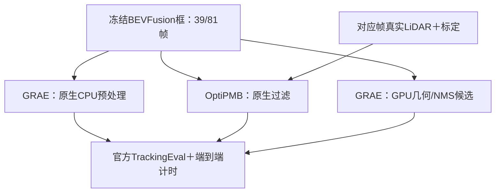

# 2026-10-13_03：固定BEVFusion检测的跟踪对照与GPU几何算子优化

## 授权目标与执行范围

BOSS授权：固定BEVFusion检测输出比较OptiPMB与GRAE，先验证跟踪收益；拆解GRAE的CPU几何/NMS热点，按原始三维高度、类别、排序和阈值语义开发批量旋转框IoU与NMS GPU算子；用TileLang＋KernelBench实现与验证，再研究BEV pooling；GPU计时包含搬运，局部收益回到整网评价。

执行项目：本地 /home/minglei/Desktop/CAR，单RTX4090。任务依据提交 [3561a28](https://github.com/pyk142857/CARperception/blob/3561a281334cac91545d3aa0e5d8977252386c69/README.md)。建议分支 codex/20261013_tracking_gpu。先读AGENTS.md、TASK_STATE.md、[调研](../reports/tracking_gpu_candidates_20261013/report.md)、[保留方案](../RETAINED_ALGORITHMS.md)。

本次执行新任务，不重跑BEVFusion来生成主跟踪对照输入，不训练、不新增全量数据、不切换Mamba检测。历史输出与旧partial记录保留。本轮报告写入 perception_lab/reports/tracking_gpu_20261013/，不覆盖原perception_2025_20261013/grae3dmot/frozen_reference。

先完成两种原生跟踪和官方评价，再开展GRAE GPU优化；最后开展有范围限制的pooling研究。一个候选无收益或受阻，仍完成其他独立阶段并及时发布真实结果。OptiPMB不必“赢”才允许剖析GRAE。



## A. 锁定输入与来源

### A1. 冻结检测与数据范围

使用以下已经global化的nuScenes results/meta文件。SHA256核对完整文件，不能只比较框数；运行前后再次核对，禁止原地裁分数、排序或改坐标后覆盖源文件。

| split | 帧/场景 | 项目根目录相对路径 | SHA256 |
|---|---|---|---|
| scene0061 | 39帧，scene-0061 | perception_lab/reports/deployment_4090_20261008/bevfusion_reference/scene0061/evaluation/official_predictions.json | dd6df55652026f2b04c7b18f9adde44123b664e8cb3706e53d6d30faca344d2f |
| mini_val | 81帧，scene-0103/scene-0916 | perception_lab/reports/deployment_4090_20261008/bevfusion_reference/mini_val/evaluation/official_predictions.json | a6fb424ccbe629f3af27172202960c4533cd48ddd887cd201f0d464ee22c56a7 |

两文件分别含7,789/16,199个原始检测框；这不是按分数筛选后的跟踪输入框数。原文件已在Git中，若本地缺失，从上述固定项目提交取回并复核hash，不能重新推理后把新输出冒充冻结输入。

对应packet：
- perception_lab/reports/deployment_4090_20261008/inputs/scene0061_packets.json，SHA256 9680b0d03e49cc78be200a9abe3b99602312123adbf8e12667b9fbbbe7d5c549。
- perception_lab/reports/deployment_4090_20261008/inputs/mini_val_packets.json，SHA256 85fba9112c777485268e116fb22d4dcee3a6533de60b70e2421d0abc547b6291。

固定七个tracking类：bicycle、bus、car、motorcycle、pedestrian、trailer、truck。按各作者类名映射到自己的索引，不能复用另一实现的整数顺序。字段：global xyz（米）、size=[w,l,h]、rotation=[w,x,y,z]、global xy velocity（m/s）、原始detection_score及detection_name；frame/sample/scene token与LIDAR_TOP真实时间戳来自packet，时间差使用秒，不硬编码0.5s。源框已经global，不能再次ego→global。

两算法都从同一原始检测文件读取，但各自保留作者原生NMS、分数阈值和生命周期规则，分别记录筛选前后框数、参数及中间输入hash。不要强迫OptiPMB复用GRAE的NMS后结果来冒充作者原生比较。若以后补共同预处理对照，独立命名，不能覆盖主表。显示score0.25只用于教学案例，不裁官方评价预测。

### A2. OptiPMB还需要真实点云

源码已核查：OptiPMB_Filter.preprocess_measurments读取pts_meas/pts_meas_global，移除距离≤3m的点，并统计三维框内点数used_bbox_pt_num；原生配置含enable_P_d_scaling等依赖该统计的项。不能提供空/全零点云、常量点数或关闭这条路径后称原生。

复用现有nuScenes mini每个对应keyframe的真实LIDAR_TOP单帧点云、remission和传感器标定/位姿，按作者preprocess_data.py准备sensor与global两种点坐标，不新增检测历史sweeps。逐帧记录原始文件hash、点数、变换hash与坐标往返检查；真实点云只在本地，报告保存证据。固定检测输出不禁止复用本次算法确实需要的现有点云。

GRAE本次仅消费预测框，OptiPMB还利用点数；报告明确辅助信息差异，结论为“相同冻结检测上的原生跟踪系统比较”，不能把全部收益归为PMB关联模块。该发现也补入调研说明。GT只在推理完成后进入评价/绘图，Opti适配器不加载真实GT框、instance token或GT ID。

### A3. 固定源码、权重与工具

| 项目 | 固定版本与要求 |
|---|---|
| OptiPMB | https://github.com/dinggh0817/OptiPMB ，commit ed0e0467efb08fd8a96b03647b09169564a74acd；使用trackers/OptiPMB/nuscenes_centerpoint_config_optipmb.json，标为“作者CenterPoint默认配置应用于固定BEVFusion输出”，不改名伪称作者BEVFusion配置 |
| GRAE | 复用现有作者源码63def8bde5e199a4e77fdf4fab76a4b3511fe132、完整model.pth，SHA256 9da45f9cfce1b4949bcd92d61193b88e09fea59c37f7b0a963249aad83728395；strict加载162个state tensors，沿用已核对的两个精确前缀映射 |
| SimpleTrack NMS依赖 | 05c96bb7ed98fc179856f327544612a66c839b5e；只作NMS参考，不运行旧跟踪器 |
| TileLang | 优先稳定v0.1.15，commit a35f8ddf45eba16c21211ec8822d56ce5363036f；独立环境，在4090/SM89先运行最小FP32 kernel；若已存在兼容稳定版本优先复用并记录精确版本与原因，不升级旧GRAE/BEVFusion环境 |
| KernelBench | 423217d9fda91e0c2d67e4a43bf62f96f6d104f1；复用本地正确性/计时工具，新增本项目任务适配；不要求跑完250题，不调用付费生成服务或云GPU |

OptiPMB跟踪部分没有待下载的网络权重，直接用作者过滤器。FastMurty原生库必须真实可调用；预编译.so不兼容则从作者链接的FastMurty源码编译并验证小型已知代价矩阵，不换成另一个关联算法。保存依赖源码版本、库hash及加载位置。CPU准备/编译可独立推进，GPU执行与性能测量串行。

## B. 原生跟踪对照：先得到收益结论

新增最小mini适配与独立报告入口，复用现有工具及评价代码。建议新runner为tools/run_tracking_gpu_20261013.py，支持inputs/native_compare/profile/kernel/benchmark/full_eval/bev_pooling/report等阶段；这些是待实现接口，发布指令不代表它们已存在。实现后在run_commands.md给出真实可运行命令。不要重做通用实验平台。

GRAE复用tools/grae3dmot_2025.py的加载、frame_arrays、run_sequence和官方评价，但该工具OUT硬编码到旧目录，必须提供新的输出目录适配，保持旧默认和旧文件不变；不能直接运行旧run后覆盖历史frozen_reference。

OptiPMB：
- 保留作者OptiPMB_Filter及predict/update/prune/extract_states的实际执行顺序；复用作者format_measurements和结果组装的可追溯实现，仅适配mini输入、字段和输出。
- 作者默认Run_OptiPMB.py只接受train/val/test，并加载含点云/GT的聚合文件，不能直接把mini改名为val。写预测/点云专用reader，关闭作者GT绘图与自动全val/HOTA入口，正式输出取online_results，禁止把offline_results或后续平滑补出的历史结果作为在线输出。
- 作者内部bbox_hwlxyza为[h,w,l,x,y,z,yaw]，nuScenes输入size为[w,l,h]；明确映射，四元数/朝向按作者转换。保持global坐标与原始速度。
- 参数按原生配置首轮固定，不用mini_val GT调分数、出生/剪枝参数。记录每类参数、NMS、存在概率、分数缩放与点数依赖；分数修改属于算法输出，不改冻结源检测。
- Opti与GRAE跨scene重新初始化。做首/中/末真实调用、空帧、场景重置、固定前缀重放；验证同一前缀的在线输出不受未来帧影响。Hook/计数证明Opti预处理、点数统计、过滤与FastMurty实际执行，GRAE空间/时空编码及关联模块实际执行。Hook验证与正式计时分开。

两算法重新运行39与81帧、完整覆盖sample token。本次预测新生成，历史GRAE表只作核对：
- scene0061：AMOTA0.8625687017631094，AMOTP0.4048811070336119，IDS5、FP67、FN104。
- mini_val：AMOTA0.8229635568204605，AMOTP0.43518577589429613，IDS13、FP299、FN400。
复跑不一致先定位来源/适配/重复噪声，不能拿历史指标填新运行。

用同一未修改nuscenes-devkit 1.2.0 TrackingEval/config_factory('tracking_nips_2019')。复用envs/sparse4d作为评价环境，仅运行评价；scene0061独立自定义split、mini_val官方split。保存官方配置、预测/指标/GT范围hash及每类详情，分别报告AMOTA、AMOTP、IDS、FP、FN、Recall、MOTA。保持全套官方阈值与插值流程；输出框在官方分数排序前不得用显示阈值截断。

判定：
- 81帧AMOTA提高，且IDS/FP/FN不增：本范围收益成立，继续列出39帧表现及逐类变化。
- AMOTA提高但身份/FP/FN退化：tradeoff，明确是哪项代价，不能称全面改善。
- 无提升：保留GRAE和原始失败结果，照常推进其GPU优化。
mini结果只作为教学/本范围判断，不称全量val或独立泛化结论。

原生对比报告先落盘并发布，避免后续编译让已完成的跟踪结论不可见。

## C. 剖析GRAE CPU热点并冻结算子语义

按全部120帧记录框数与各段耗时：JSON读取、七类筛选、数组/BBox构造、yaw转换、粗网格构建、候选筛选、旋转交集面积/高度交叠、贪心抑制、结果索引、score过滤。用cProfile/采样与同步分段计时；比较有/无插桩总耗时，最终基准关闭诊断Hook。原报告139.56/240.84ms属于旧CPU reader/NMS段，不能当纯IoU时间或本次独占基准。

已核查的真实调用链必须写入geometry_contract.md：
1. 当前frame_arrays先七类allowlist，用float64构造translation/size/quaternion/velocity与score；SimpleTrack BBox w=size[0]、l=size[1]、h=size[2]，o=Quaternion(rotation).yaw_pitch_roll[0]。
2. 调用official_nms(bboxes, classes, 0.1)，即threshold_low=0.1、默认threshold_high=1.0、threshold_yaw=0.3；之后才mask score>=0.1。不能为了提速把分数过滤提前。
3. 排序为np.argsort(scores)[::-1]；同分时不能换成另一种稳定排序。第一版复用CPU原排序，把明确的order传给GPU。
4. BBoxCoarseFilter(grid_size=100, scaler=100)用框角点min/max的floor网格键和set关系产生eligible pairs，NMS只计算当前order中粗筛相关且同类的框。第一版复用CPU粗筛关系后GPU化几何；全N×N几何可以作独立微基准，但NMS不能静默扩大配对集合。
5. 原nms逐个取最高剩余score，按iou3d(...)[1] > threshold_low删除，严格“>”，不是“>=”；返回原始indices与types。原投票分支的实际输入/可见输出及副作用也核对，不擅自新增框平均或分数变更。
6. 原iou3d使用旋转BEV多边形交集面积、z±h/2，分母union_volume+1e-5；不是二维NMS，也不是BEV IoU。

重要上游差异：SimpleTrack iou3d的overlap_height实际为
```python
max(0, min((za + ha/2) - (zb - hb/2),
           (zb + hb/2) - (za - ha/2)))
```
它未额外与ha/hb取min，包含高度时与物理标准交叠公式可能不同。本轮等价加速必须复现这条原公式；若要修正，另存geometry_corrected变体、单独跑指标，不能混入“同算法GPU提速”。不以OpenPCDet默认3D/BEV NMS或TensorRT普通二维NMS直接代替。

保存原依赖文件hash与实际源码差异：mot_3d/preprocessing/nms.py、bbox_coarse_hash.py、utils/geometry.py、data_protos/bbox.py。若旧环境np.int兼容别名有补丁，一并记录，不能把未执行的上游版本当参考。

## D. TileLang实现与KernelBench验证

先用TileLang写可实际调用的批量旋转矩形交集/原式三维IoU，再实现接收原order/eligible/class的GPU贪心NMS；可以通过成对bitmask（用位表示是否抑制）减少内存及主机循环。第一版保持CPU排序/粗筛，整段计时把它们计入；其后才单独尝试同语义GPU化。允许CUDA C++辅助绑定/边界处理，但TileLang计算kernel必须真实运行，不以包装CPU或仅跑样例声称完成。

TileLang编译环境与旧GRAE环境可能不同。优先用最小绑定把编译kernel集成到真实GRAE调用；也可在兼容的独立整合环境重新建立同环境CPU原生参考再比较。禁止每帧单独进程调用后把启动/IPC/搬运放到计时外；若必须跨进程，全部计入第E节全链路。环境变更、编译器/CUDA、实际加载库均绑定hash，不能仅用独立kernel demo证明整网已接入。

保护原float64输入；可先用FP64几何保证参考一致，再作为独立候选测试FP32。不得直接用FP16几何、丢高度或近似包围矩形换速度。默认浮点诊断FP32 atol/rtol=1e-5，FP64 atol=1e-8、rtol=1e-7；保存绝对/相对误差与最差样例。最终NMS保留indices、顺序、types必须精确一致。阈值附近可采用明确记录的高精度/CPU边界复核，复核比例和时间全部计入；不能普遍回退CPU伪装GPU。

至少覆盖：
- 空、单框、64位mask的63/64/65边界、真实帧及实际最大框数。
- 同类/异类、相等分数、输入顺序变化、重复框、touching、无交集、±π附近旋转。
- 同XY但Z分离、不同高度且互相包含；固定点构造IoU在0.1前/等于/后的用例，同时覆盖默认high/yaw条件。
- 粗网格边界和负坐标、world坐标偏移、非正尺寸、非有限值按原调用边界处理。
原CPU入口异常/不终止的合成输入独立记录reference_failure，不冒充通过，也不静默修正主参考。

KernelBench固定版本src/kernelbench/eval.py目前_process_input_tensor会把所有tensor强制转precision，默认FP32容差1e-4、FP16容差1e-2；其注释还称TileLang仅fp16。不要因此把class/order/indices转float、把geometry降FP16或用allclose验证整数NMS结果。
新增最小任务适配，保持每个参数dtype，整数输出用精确比较，项目几何预算单独校验。可复用KernelBench eval/timing helper，并对必要适配保存diff与测试，标为“项目任务扩展”，不冒称标准250题成绩。验证真实输入＋固定随机seed，报告CPU原始参考、PyTorch参考可用部分、TileLang候选的边界区别；CPU Shapely往返GPU的参考包装耗时不能称纯GPU kernel基线。

必须有执行证据：实际输入hash/shape/dtype、TileLang源码与编译产物标识、实际kernel启动/调用次数、输出hash。每个代表帧不得零调用。NVTX/Profiler/Nsight可用则记录；NCU权限不可用时使用真实CUDA events与时间线，仍完成实现，不编造硬件计数器。

## E. 配对性能与完整GRAE评价

三层计时单独列：
1. device-resident kernel：输入已在GPU，仅几何/抑制CUDA events，不含拷贝。
2. CPU detections→可消费NMS结果：包括排序/粗筛、打包、H2D、kernel、同步、D2H、边界复核及结果重建。
3. 冻结检测文件→可消费tracks的完整GRAE：包括JSON读取、全部预处理、H2D、原网络forward、关联、D2H和导出；排除GT评价、视频、磁盘输出，冷导入/权重加载/JIT编译另列。

第3层是GRAE跟踪整网/全链路，不包括本次没有执行的BEVFusion前向，不能称整个感知系统端到端FPS。网络forward是关联子区间，不能重复相加。模型与权重、关联/生命周期不变，GPU优化只替换已核验的预处理实现。

基准至少30轮交错AB/BA，同一实际输入和暖缓存，双方都预热且记录顺序：
- 算子层：三个scene各首/中/末，共9个代表帧，覆盖低/中/高候选数；逐帧配对，不平均掉尺寸差异。
- 完整GRAE：同三个scene的连续三帧窗口，各自从相同scene起点重放前缀获得状态，前缀在窗口计时外；不能将单帧reset后计时冒称连续跟踪。若作者入口不能安全分段，则直接用完整39/81帧序列配对，避免修改关联数学来切窗口。
- 至少记录CPU/GPU各自mean、P50、P95、每轮原始数据、AB/BA分组、H2D/D2H、GPU allocated/reserved/进程总使用边界及CPU内存。性能运行关闭Hook；记录外部GPU进程/占用变化，受竞争污染的轮次保留并在空闲时重测，不能无依据选最好轮次。

正确性通过后，GPU预处理再完整运行39/81帧GRAE并官方评价：
- 全120帧NMS indices/order/types与CPU精确一致，模型输入字节hash一致，场景轨迹ID/字段/顺序一致；浮点网络输出先与同后端重复基线核对，不掩盖新差异。
- 官方AMOTA/AMOTP/IDS/FP/FN应与本次CPU原生参考一致；如果不一致，定位并修复，不能仅称“AP预算内”采用。
- 稳定速度要求AB/BA两组的全链路平均都改善，至少24/30配对轮次更快、P95不增加。完整GRAE平均节省达到5%才列为默认采用建议；低于此幅度仍报告真实收益，标为小收益候选；局部快但整网慢、顺序依赖或数值失败则保留CPU原生。
OptiPMB与GRAE的算法比较计时各自包含其必要输入，Opti点云读入/变换与点数统计不得藏到计时外。算法比较与同GRAE CPU/GPU优化分两张表。

## F. 最后研究BEV pooling

先发布B–E结果，再复用原bev_pooling_4090.py、bev_pooling_full_model.py、既有真实首/中/末capture与上游实现研究一个明确方向。遵守已有原生FP32/FP16布局及累加预算，不为研究pooling阻塞跟踪结论。

- 测实际depth/feature/ranks/intervals/output大小、有效投影数、interval长度分布、热点与数据搬运。与当前CUDA-BEVFusion/upstream比较，不用更早V2基线的论文倍率当本机收益。
- 优先索引分离/预计算、减少重复读写、区间归属写回；保持几何区间末端边界、输入排序及有效投影覆盖。根据profile选择一种，不同时叠加多个难以归因的改动。
- TileLang原型或CUDA候选需正确性＋30轮交错配对。若有稳定局部收益，则固定原BEVFusion权重/配置对39/81帧做单独整网检测评价与全模型计时；新预测存独立变体目录，禁止替换A1冻结检测或重写已完成的跟踪对照。
- BF整网mAP/NDS下降绝对值各≤0.005，几何/中间张量及重复性均按原部署预算验证，不因指标预算通过就忽略失败；混合精度/改变累加次序单独标识。
- 没有稳定收益则保留上游，提交完整热点分析及候选失败原因，本阶段research完成与optimization_adopted分开。BEVPoolV3资料仅作为思路参考，完整V3插件源码尚未确认，不虚构下载/部署完成。

## G. 产物、可视化与完成判定

本轮目录 perception_lab/reports/tracking_gpu_20261013/ 至少保存：
- report.md/status.json/run_commands.md：按阶段列实际状态、完整环境、来源、版本、执行脚本hash、采用结论和剩余问题。
- input_manifest.json：两冻结预测hash、split/tokens/timestamps、原始点云hash/点数/变换、原生参数和中间框数。
- native_compare/：OptiPMB/GRAE的39/81预测、官方指标/每类结果、在线性/状态验证、实际调用证据。
- geometry_contract.md、cpu_profile.json、kernel_correctness.json、kernelbench/：真实调用、上游特殊公式、fixture与实际数据结果、框架适配diff。
- paired_benchmark.json与逐帧/逐轮CSV：三层计时、AB/BA、输入hash、显存和候选采用。
- grae_gpu/及bev_pooling/：各阶段实际预测/指标或失败证据，不填未测论文数字。

用现有Rerun/9094新增独立OptiPMB/GRAE对照入口，原BEV检测与GT分别展示；39/81帧检查首/中/末、跨scene、ID颜色和清除。优先展示改善、退化及误检/漏检各类实际片段，选例规则固定并保存token；没有改善不制造改善图。GPU版同输出时给等价检查证据，无需为了新图层重复绘制相同结果。保存浏览器验证与截图。

status逐项区分：inputs_frozen、native_comparison_complete、cpu_semantics_profile_complete、tilelang_kernel_executed、kernel_equivalence、kernelbench_validation、grae_full_evaluation、paired_performance、bev_pooling_research、visualization、publication。每项pending/passed/failed/blocked/not_adopted按实际填写；tracking_benefit与gpu_speedup_adopted另外填写。任务执行完成不代表每个候选都改善，性能失败不能被CPU单元测试覆盖成passed。

新增必要测试仅覆盖字段/高度/类别/排序/阈值、在线性、prefix/scene reset、typed KernelBench适配与GPU边界；实际GPU正确性/真实120帧/官方评价/配对计时均须完成并保存证据。测试不能替代模块执行。

实施中遇到依赖或编译失败自行定位、换兼容构建路线并保存原因；可独立完成的CPU/原生评价/文档继续推进。不要无限重试同一失败，不追加别的模型、训练和全量数据来绕开任务。已有服务不被无关任务随意终止，GPU测量避开竞争并如实记录。

按AGENTS既有授权发布必要代码、配置、可分享报告及README/TASK_STATE入口到本仓库，阶段结果及时上传；核对远端提交SHA和主要文件。权重、虚拟环境、原始点云和大缓存继续留本地；大型产物保存来源/hash/复现方式。完成后更新RETAINED_ALGORITHMS与简历仅纳入本次实证收益。

## 已核对的直接入口

- [原冻结检测清单](https://github.com/pyk142857/CARperception/blob/3561a281334cac91545d3aa0e5d8977252386c69/perception_lab/reports/perception_2025_20261013/grae3dmot/frozen_reference/input_manifest.json)、[原GRAE适配器](https://github.com/pyk142857/CARperception/blob/3561a281334cac91545d3aa0e5d8977252386c69/perception_lab/tools/grae3dmot_2025.py)。
- [OptiPMB过滤器](https://github.com/dinggh0817/OptiPMB/blob/ed0e0467efb08fd8a96b03647b09169564a74acd/trackers/OptiPMB/OptiPMB_Tracker.py)、[原生runner](https://github.com/dinggh0817/OptiPMB/blob/ed0e0467efb08fd8a96b03647b09169564a74acd/Run_OptiPMB.py)、[点云准备](https://github.com/dinggh0817/OptiPMB/blob/ed0e0467efb08fd8a96b03647b09169564a74acd/preprocess_data.py)。
- [SimpleTrack NMS](https://github.com/tusen-ai/SimpleTrack/blob/05c96bb7ed98fc179856f327544612a66c839b5e/mot_3d/preprocessing/nms.py)、[几何公式](https://github.com/tusen-ai/SimpleTrack/blob/05c96bb7ed98fc179856f327544612a66c839b5e/mot_3d/utils/geometry.py)、[粗筛](https://github.com/tusen-ai/SimpleTrack/blob/05c96bb7ed98fc179856f327544612a66c839b5e/mot_3d/preprocessing/bbox_coarse_hash.py)。
- [TileLang固定稳定源码](https://github.com/tile-ai/tilelang/tree/a35f8ddf45eba16c21211ec8822d56ce5363036f)、[KernelBench实际eval](https://github.com/ScalingIntelligence/KernelBench/blob/423217d9fda91e0c2d67e4a43bf62f96f6d104f1/src/kernelbench/eval.py)。
