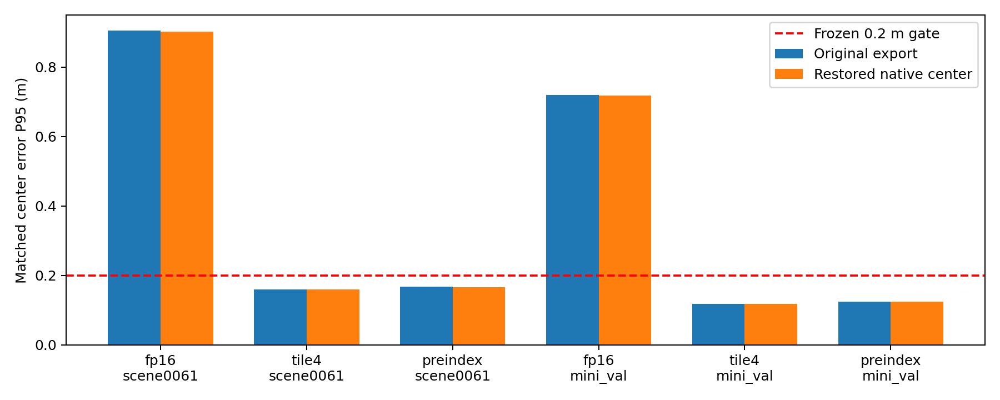

# 中心约定修正后的优化可行性复核（2026-10-19）

BOSS 提出的重新评估已完成三组检测后端/算子候选的几何重算及十组官方 DetectionEval。半高偏移解释了六相机投影错位，但不足以解释 FP16 后端的大中心差异。现有 FP16 与两组 pooling 不采用结论不变。

## 范围与方法

nuScenes mini scene-0061（39帧）和 mini_val（81帧）；两者有重叠，不能合计为120个独立样本。使用原有 FP32、TRT FP16、tile4 pooling、重编译 upstream、preindex 的封存预测；模型、权重和配置身份由 source_receipts.json 的来源 manifest 哈希绑定。没有新推理或性能计时。

对每个框只执行 `ego_center -= T_lidar_to_ego[:3,2] * height / 2`，恢复已由作者可视化及 native tensor 核验的中心语义。原预测、分数、尺寸、旋转、速度、框数及冻结跟踪输入均保留。不是沿世界 Z 轴统一平移，也不使用真值拟合偏移。修正产物独立保存。

既保留原 Hungarian 配对重算，也按同类别、3D距离2米门限重新匹配；验收继续使用全部候选以及原来固定的 P95 阈值，未用高分子集替代。官方评价使用 detection_cvpr_2019；39帧是自定义 mini_scene_0061，81帧是 mini_val。这是 mini 教学诊断，不是全量评测。

## 几何差异

|对比|范围|原中心P95/m|修正中心P95/m|固定原配对P95/m|修正后全部几何门限|
|---|---|---:|---:|---:|---|
|fp16|scene0061|0.905122|0.902313|0.888927|center_m, size_m, yaw_rad, score_abs|
|tile4|scene0061|0.159316|0.159118|0.159118|通过|
|preindex|scene0061|0.167708|0.166142|0.166142|通过|
|fp16|mini_val|0.720256|0.717998|0.717463|center_m, size_m, yaw_rad|
|tile4|mini_val|0.118679|0.118788|0.118788|通过|
|preindex|mini_val|0.124250|0.124772|0.124772|通过|



两端共同多加的半高大体抵消；固定配对的误差变化绝对值不超过两端框高差的一半，脚本逐框验证该上界。重新匹配可改变少量配对，所以同时报告固定配对，避免将匹配变化误归因为数值改善。

## 重新运行的官方检测评价

|模型|范围|原mAP|修正mAP|原NDS|修正NDS|
|---|---|---:|---:|---:|---:|
|fp32|scene0061|0.711761|0.712508|0.622348|0.623276|
|trt|scene0061|0.709706|0.710484|0.621329|0.622176|
|tile4|scene0061|0.710228|0.711332|0.621592|0.622590|
|rebuilt_upstream|scene0061|0.710627|0.711131|0.621758|0.622500|
|preindex|scene0061|0.710133|0.710941|0.621536|0.622440|
|fp32|mini_val|0.579033|0.580859|0.514471|0.515868|
|trt|mini_val|0.576408|0.578707|0.513238|0.514864|
|tile4|mini_val|0.576025|0.578319|0.512941|0.514562|
|rebuilt_upstream|mini_val|0.576824|0.579225|0.513460|0.515145|
|preindex|mini_val|0.576630|0.578993|0.513240|0.514909|

|候选|范围|修正后mAP下降|修正后NDS下降|0.005官方指标预算|
|---|---|---:|---:|---|
|fp16|scene0061|0.002024|0.001101|通过|
|tile4|scene0061|-0.000849|-0.000415|通过|
|preindex|scene0061|0.000190|0.000060|通过|
|fp16|mini_val|0.002153|0.001004|通过|
|tile4|mini_val|0.000388|0.000302|通过|
|preindex|mini_val|0.000233|0.000236|通过|

官方检测的中心匹配使用地平面距离，不能靠 mAP/NDS 判断高度正确；LiDAR 轴旋转后修正也可能影响平面分量。因此本次实际重跑，而非假定指标不变。

## 可行性决定

- **BEVFusion TensorRT FP16：暂不采用。** 修正后仍有几何门限失败；历史同输入张量、yaw、depth scatter/候选变化问题未被中心修正消除。后续应从相同中间输入和原始 query 对齐定位数值分歧，不应仅放宽中心阈值。见[原一致性诊断](../deployment_4090_20261012_followup/report.md)。
- **旧 tile4 pooling：不采用。** 高度修正不能改变已实测的整网30轮仅13轮胜出、平均节省为负的时间事实。
- **新 preindex pooling：保留研究，不替换默认。** 修正后几何门限通过；历史局部收益仍在，但9组完整链路配对胜率未达到24/30，稳定整网收益不成立。见[pooling记录](../tracking_gpu_20261013/bev_pooling/report.md)。
- **TileLang GRAE IoU/NMS：历史等价与加速证据保留，修正输入的验收待补。** 两实现作用于相同旧输入时的 NMS顺序、轨迹、官方指标一致及87.09%节省并未因此失效；但高度改变可能改变真实3D IoU、NMS和关联。不能把旧 AMOTA 或速度直接标为修正输入结果。本轮没有重跑修正输入的跟踪或30轮计时。重新发布该输入上的采用结论前，需要冻结修正预测哈希、CPU/GPU逐帧NMS与轨迹对照、官方跟踪评价，再进行39/81帧各30轮AB/BA。

## 证据、复现和局限

`source_receipts.json`：输入/manifest/packet/修正预测 SHA256；`geometry_summary.json`：全部门限、匹配变化、高分诊断；`comparisons/**/fixed_pair_errors.csv`：逐对误差；`corrected/**/official/metrics/metrics_summary.json`：十次新评测；`official_summary.*` 和 `acceptance_summary.json`：汇总。大型派生预测及详细曲线留在本地、不入库，可按封存来源再生成；所有公开摘要、逐框对比和校验收据入库。

```bash
perception_lab/envs/sparse4d/bin/python -m pytest -q perception_lab/tests/test_center_reassessment_20261019.py
perception_lab/envs/sparse4d/bin/python perception_lab/tools/center_reassessment_20261019.py prepare
perception_lab/envs/sparse4d/bin/python perception_lab/tools/center_reassessment_20261019.py evaluate
perception_lab/envs/sparse4d/bin/python perception_lab/tools/center_reassessment_report_20261019.py
```

复现需要原实验来源文件及 nuScenes mini，本仓库不分发数据集/权重。本轮是确定性产物复核，没有新训练种子或独立性能试验；逐框统计存在时间相关，不计算虚假的显著性或泛化置信区间。旧导出程序/engine未在本轮切换，后续新推理仍须显式统一中心约定，禁止重复修正已经使用 native 中心的记录。
