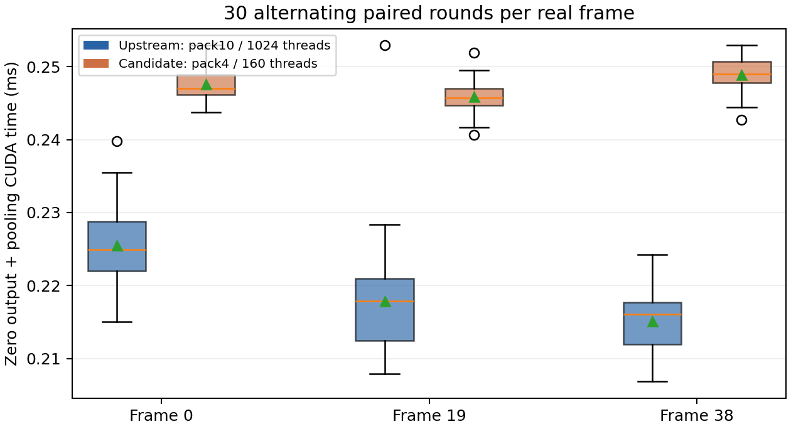

# BEV pooling candidate experiment on RTX4090

The custom tile4 CUDA candidate is numerically correct on the tested inputs, but **slower than the NVIDIA upstream kernel**. The deployment default remains upstream. This is a completed candidate experiment, not a successful speed optimization.

## Actual implementation and inputs

`tools/bev_pooling_candidate.patch` modifies NVIDIA CUDA-BEVFusion `camera-bevpool.cu` at the source commit recorded by S2. `CAR_BEV_POOLING=candidate` selects four adjacent FP16 channels per thread with a `(20,8)` thread block (160 threads); default `upstream` keeps ten channels per thread and `(8,128)` (1024 threads). Both preserve the exact original interval/point order, float32 FMA accumulation and final half conversion. No atomics, approximate arithmetic or output rescaling are introduced. The reduction and standalone benchmark call the same exported C ABI dispatcher used by the complete model.

The candidate was motivated by highly uneven real interval lengths and reducing register pressure and block size. Three **actual CUDA/TensorRT pipeline captures**, scene-0061 frames 0/19/38, contain the real NHWC camera feature, NDHW depth probability, sorted indices, interval triples and reference NCHW output. Model tensor shape is `[6,80,118,32,88]`; output is `[1,80,360,360]` (10,368,000 half values). The captured interval counts are 97,326 / 96,046 / 96,306, each with 1–889 contributing points per cell, median 14, and P95 49–50. Feature/depth/index byte hashes are in `input_statistics.json` and `results.json`. These captures cover the smallest and largest interval counts among the three sampled frames; the study does not claim they are extrema over every mini frame.

Optional `CAR_BEV_POOL_CAPTURE=<existing-directory/prefix>` serializes inputs/output once per prefix. Root runner captures occur on separate untimed passes. Local captures live under `runs/deployment_4090_20261008/trt_pooling_captures/`. Earlier S1 lifted-feature captures are separate artifacts and were not substituted for the measured S2 inputs.

## Correctness and bounds

The predeclared FP16 tolerance is `atol=0.02, rtol=0.002` from the configuration hashed in `results.json`. Candidate and upstream outputs are **bitwise identical**, max absolute error 0, on all three real captures. Recomputing the upstream kernel also exactly matches each saved pipeline output. All values are finite.

The same compiled kernels pass empty-valid-projection, single-point, four-contribution same-cell collision, and last-input/last-output boundary checks. A small independent CPU sum verifies these boundary cases. The new shared host dispatcher explicitly returns zeros for empty intervals, avoiding an invalid zero-grid launch; nonempty upstream semantics are unchanged. Input validation checks interval bounds, unique destination cells and in-range source indices before calling CUDA.

Compute Sanitizer memcheck reports **0 errors** for all four edge cases and for the full real frame-0 upstream/candidate pair. Logs: `sanitizer_edges.log`, `sanitizer_real.log`. Numerical validation is distinct from memory-error checking.

## Paired measurement

The required unified CLI was executed successfully:

```bash
cd perception_lab
python3 tools/run_4090_deployment.py --config configs/deployment_4090.yaml --stage bev_pooling
```

Each real case has 10 independent warmups per backend and 30 pairs, alternating which implementation runs first. The CUDA-event interval includes output zeroing plus the reduction kernel for both implementations, using identical preallocated GPU inputs and outputs. It excludes H2D/D2H, input sorting, allocation, capture I/O and visualization. Synchronization surrounds each measured call. Ninety raw pairs are retained in `paired_timings.csv`.

| Capture | Upstream P50/P95 ms | Candidate P50/P95 ms | Median paired speedup |
|---|---:|---:|---:|
| frame_0 | 0.224896/0.233605 | 0.247024/0.250344 | 0.910× |
| frame_19 | 0.217840/0.226970 | 0.245760/0.249184 | 0.882× |
| frame_38 | 0.216064/0.220723 | 0.248960/0.252027 | 0.869× |



All three median speedups are below 1, so the candidate is rejected as the default. Kernel results are not presented as whole-model acceleration. Full-model candidate-versus-upstream evaluation was subsequently completed on both fixed splits with the same engines, inputs and decoder; results are below.

## Profiling evidence and limitations

Nsight Systems successfully traced the real upstream/candidate pair. `nsys_gpukernsum.csv`, `nsys_gpumemtimesum.csv` and `nsys_kernel_resources.json` preserve kernel/memory evidence; the full local trace is `runs/deployment_4090_20261008/pooling_nsys.nsys-rep`. The trace confirms the intended block mapping: upstream 761 blocks ×1024 threads, candidate 12,166 blocks ×160 threads. Actual compiled register usage only falls from **40 to 38 registers/thread**, not the large drop hoped for. No per-thread local memory is reported. The candidate launches 2.5 times as many channel workers and roughly 16 times as many blocks, while repeating index/depth work more often. This provides a plausible explanation for the failed optimization; it is not a measured cache/bandwidth bottleneck diagnosis.

Nsight Compute was actually invoked with both kernel-name filters and `--set full`, but returned `ERR_NVGPUCTRPERM`: this account cannot access NVIDIA performance counters. The failure log is `ncu.log`. Achieved occupancy, memory-transaction efficiency and hardware stall counters are therefore **not measured**. No driver permission or global configuration was changed. The single Nsight trace pair is diagnostic and does not replace the warm repeated benchmark.

Full S2 model timing decomposition is recorded by its native core timer. A correct candidate-versus-upstream pooling comparison does not establish separate TensorRT-versus-PyTorch acceptance.

## Complete-model comparison

The candidate subsequently executed all 39 scene-0061 frames and all 81 mini_val frames using the final LayerNorm-plugin TensorRT engines. `full_model_comparison.json` verifies the same checkpoint, ONNX files, engines, native/core shared libraries, deployment configuration, packet list, and **every preprocessed image/point/matrix hash** for upstream and candidate. Only the runtime pooling selector changes. All frames have standardized predictions and original backend outputs in `outputs/bevfusion_tensorrt_candidate/<split>/`; their run manifests preserve provenance. Official candidate evaluation and complete matched-box diagnostics are published in `full_model/<split>/`.

| Split | Upstream mAP/NDS | Candidate mAP/NDS | ΔmAP / ΔNDS | Fixed correctness budget |
|---|---:|---:|---:|---|
| scene0061 (39 frames) | 0.710583/0.621810 | 0.710023/0.621469 | -0.000559/-0.000341 | passed |
| mini_val (81 frames) | 0.576388/0.513211 | 0.576555/0.513283 | +0.000167/+0.000072 | passed |

Both splits satisfy the predeclared maximum 0.005 mAP/NDS drop and all fixed P95 center, size, orientation, score and velocity diagnostic limits. Per-class AP deltas and unmatched boxes are retained rather than hidden. Whole-model outputs are **not bitwise identical** even though isolated pooling is; other native GPU stages have possible nondeterminism. No root cause of whole-model variation was experimentally isolated, so it remains a hypothesis. These comparisons are against the exact upstream TensorRT model, not against PyTorch.

A separate resident-core run used the same actual first-frame FP16 CPU arrays and one geometry update, then 10 independent warmups per mode and 30 alternating full-forward pairs. It includes true H2D, model and native-box D2H work, with synchronized wall timing; it excludes preprocessing, loading, geometry recalculation, rendering and capture I/O. Raw rows and output hashes are in `full_model_paired_timings.csv`.

Upstream full-forward mean/P50/P95: **8.476/8.581/9.669 ms**; candidate: **8.123/7.822/9.168 ms**. Mean paired saving is 0.353 ms, but an exploratory paired bootstrap 95% interval is **[-0.050, 0.742] ms**, crossing zero; candidate is faster in only 17/30 pairs. Mean saving changes from 1.149 ms when upstream runs first to -0.443 ms when candidate runs first. This strong order effect and single-frame scope do not support a stable full-model gain. **Upstream remains selected.**

## Capacity boundaries

Separate processes tested the configured 500,000-point native input capacity and a one-point input. The maximum case tiled the real preprocessed first-frame cloud and truncated exactly to 500,000 points; the minimum retained one actual point. Both returned 200 finite native boxes without a crash. These synthetic inputs test capacity only and are not accuracy data or representative warm latency measurements. The one-call cold timings are explicitly separated in `capacity_max.json` and `capacity_min.json`.

An independent CPU check executes the actual runner point-count guard extracted from its AST: 500,001 points raises its existing capacity error before backend execution (`capacity_reject.json`). The dense image engines have fixed shapes; 500,000 is the native point buffer/voxelization capacity, not a claim of a dynamic TensorRT image profile.

Reproduce candidate inference using `CAR_BEV_POOLING=candidate` and `tools/bevfusion_trt_4090.py --paired-pooling-rounds 30` on scene-0061, then the same runner without pairing on mini_val. Evaluate each output with `tools/bevfusion_evaluate.py`, and summarize with:

```bash
envs/nuscenes_eval/bin/python tools/bev_pooling_full_model.py
```
