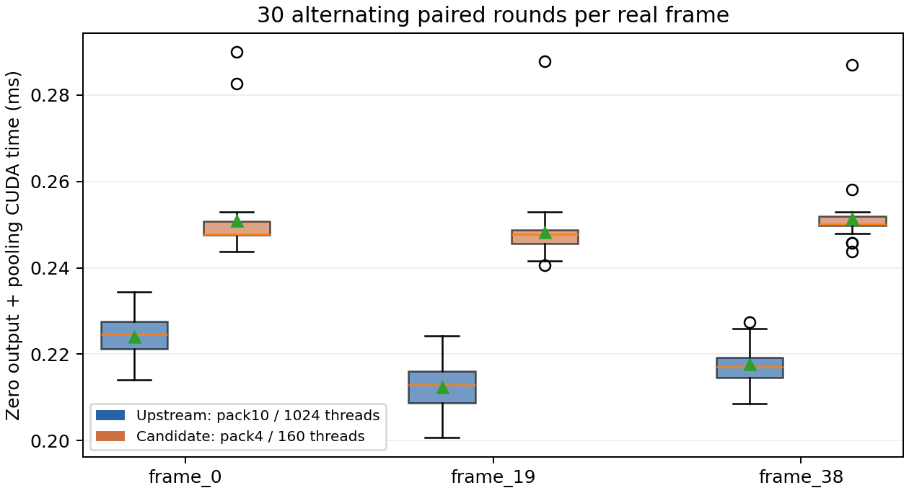

# BEV pooling candidate experiment on RTX4090

The custom CUDA candidate passes the measured numerical checks, but does not establish stable speed improvement. **The upstream kernel remains the deployment default.** This report is generated from current JSON/CSV evidence by `tools/bev_pooling_report.py`.

## Implementation and actual inputs

`tools/bev_pooling_candidate.patch` modifies NVIDIA CUDA-BEVFusion `camera-bevpool.cu`. `CAR_BEV_POOLING=candidate` selects four adjacent FP16 channels per thread, using block `(20,8)` (160 threads). Default upstream retains ten channels per thread and block `(8,128)` (1024 threads). Both execute the same interval/point order, FP32 FMA accumulation and final half conversion; no atomics or approximate arithmetic are added. The complete model and paired benchmark call the same compiled C ABI dispatcher.

Three real CUDA/TensorRT pipeline captures from scene-0061 frames 0/19/38 contain NHWC camera features, NDHW depth probabilities, uint32 indices, int32 interval triples and NCHW reference output. Input shape is `[6,80,118,32,88]`; output is `[1,80,360,360]`, or 10,368,000 half values. Hashes, finite-value checks and interval distributions are retained in `input_statistics.json` and `results.json`. The three captures cover their sampled smallest/largest interval counts; they are not claimed to be extrema over every mini frame. Large inputs stay local in `runs/deployment_4090_20261008/trt_pooling_captures/`.

## Correctness and memory checks

The tolerance was fixed before measurement: FP16 atol=0.02, rtol=0.002. All three candidate/upstream/captured real outputs are **bitwise identical**, max absolute error 0.

Empty valid projections, a single point, multiple contributions to one cell, and last-input/last-output boundary cases pass numerical checks, with an independent CPU sum for the small cases. The shared host dispatcher returns a zero tensor for empty intervals, avoiding the original invalid zero-block launch. Nonempty reference accumulation semantics are unchanged. Input validation checks bounds and unique destination cells before CUDA.

Compute Sanitizer memcheck reports **0 errors** on all four edge cases and the full real frame-0 reference/candidate pair (`sanitizer_edges.log`, `sanitizer_real.log`). This is memory-safety evidence for the tested cases, separate from accuracy checks.

## Isolated paired timing

Each real case has 10 independent warmups per backend and 30 pairs with alternating order. CUDA events measure the same output-zeroing plus reduction boundary on preallocated identical inputs/outputs. H2D/D2H, sorting, allocation, capture I/O and rendering are excluded. All 90 rows are in `paired_timings.csv`.

| Capture | Upstream P50/P95 ms | Candidate P50/P95 ms | Median paired speedup |
|---|---:|---:|---:|
| frame_0 | 0.224656/0.231758 | 0.247808/0.269261 | 0.900× |
| frame_19 | 0.212896/0.219237 | 0.247808/0.251891 | 0.862× |
| frame_38 | 0.217088/0.225206 | 0.250032/0.255744 | 0.868× |



## Profiling and limitations

Nsight Systems traced the actual pair; CSV summaries and `nsys_kernel_resources.json` are published, with the full `.nsys-rep` retained locally. Actual register usage changes only from 40 to 38 registers/thread. The recorded grids are 761 blocks ×1024 threads upstream and 12,166 ×160 candidate. The candidate uses 2.5 times as many channel workers and repeats index/depth work more often. Reduced register pressure did not automatically produce faster execution. Scheduling and repeated work are plausible explanations, not a measured hardware-counter root cause.

Nsight Compute was invoked with both kernel filters and `--set full`, but failed with **ERR_NVGPUCTRPERM** because driver performance counters are inaccessible to this account (`ncu.log`). Achieved occupancy, bandwidth efficiency and stall counters were not measured; no driver settings were changed. A single traced pair is diagnostic and does not replace warmed timing distributions.

The native S2 timer recorded this final warm first-frame breakdown after three warmups. Instrumentation synchronizes stage boundaries, so these numbers are not uninstrumented P50 latency. `[NoSt] CopyLidar` is shown separately and excluded from its printed core total.

| Native stage | ms |
|---|---:|
| [NoSt] CopyLidar | 0.27904 |
| Lidar Backbone | 1.61603 |
| Camera Depth | 0.01603 |
| Camera Backbone | 2.10864 |
| Camera Bevpool | 0.22838 |
| VTransform | 0.20368 |
| Transfusion | 0.75878 |
| Head BoundingBox | 2.51389 |

## Complete-model comparison

The candidate ran both fixed splits through the final LayerNorm-plugin TensorRT engines. `full_model_comparison.json` verifies matching checkpoint, ONNX files, engines, libraries, configuration, packets and every preprocessed image/point/matrix hash. Only pooling mode changes. The summary checks every sealed inference artifact against its manifest and verifies official export audit input/output hashes before using metrics. Candidate evaluations and detailed matched/unmatched box diagnostics are under `full_model/<split>/`.

| Split | Frames | Upstream mAP/NDS | Candidate mAP/NDS | ΔmAP / ΔNDS | Correctness |
|---|---:|---:|---:|---:|---|
| scene0061 | 39 | 0.709706/0.621329 | 0.710228/0.621592 | +0.000522/+0.000262 | passed |
| mini_val | 81 | 0.576408/0.513238 | 0.576025/0.512941 | -0.000383/-0.000297 | passed |

The fixed maximum mAP/NDS drop is 0.005; fixed P95 geometry/score/velocity diagnostics and per-class AP deltas are retained. This validates candidate versus upstream TensorRT, independently of TensorRT-versus-PyTorch acceptance. Full native outputs are not assumed bitwise identical; other native GPU stages may be nondeterministic, but their variation was not isolated experimentally.

A separate resident-core run uses the same actual first-frame FP16 CPU arrays, one geometry update, 10 independent warmups per mode and 30 alternating full-forward pairs. It includes synchronized forward/H2D/native-box D2H and excludes preprocessing, geometry recalculation, loading, rendering and capture I/O. Raw timing/output hashes are in `full_model_paired_timings.csv`.

Upstream mean/P50/P95: **8.466/8.332/9.443 ms**; candidate: **8.502/8.447/9.734 ms**. Mean paired saving is -0.036 ms; exploratory bootstrap 95% interval **[-0.350, 0.282] ms**. Candidate is faster in 13/30 pairs. Mean savings grouped by upstream-first/candidate-first order are 0.239/-0.311 ms. The bootstrap assumes exchangeable pairs and is descriptive; order sensitivity and single-frame scope limit any whole-scene speed claim. Selected default: **upstream**.

## Capacity boundaries and reproduction

Separate synthetic checks tiled a real preprocessed cloud to exactly 500,000 points and retained a single actual point. Both returned 200 finite boxes without a crash (`capacity_max.json`, `capacity_min.json`); these are capacity checks, not accuracy or warmed-latency claims. A CPU test executes the actual runner's point-count guard AST and verifies 500,001 points are rejected before backend execution (`capacity_reject.json`). The dense image engines remain fixed shape: 500,000 describes native point capacity, not a dynamic image profile.

```bash
cd perception_lab
python3 tools/run_4090_deployment.py --config configs/deployment_4090.yaml --stage bev_pooling
# CPU-only verification and report regeneration from completed runs:
envs/nuscenes_eval/bin/python tools/bev_pooling_full_model.py
envs/nuscenes_eval/bin/python tools/bev_pooling_report.py
```

Large candidate outputs remain in `outputs/bevfusion_tensorrt_candidate/<split>/`; their manifests, compact timing/input audits and official evaluation evidence are published alongside this report. Raw source/engine/input/output hashes support reconstruction. No isolated-kernel ratio is presented as whole-model speedup.
