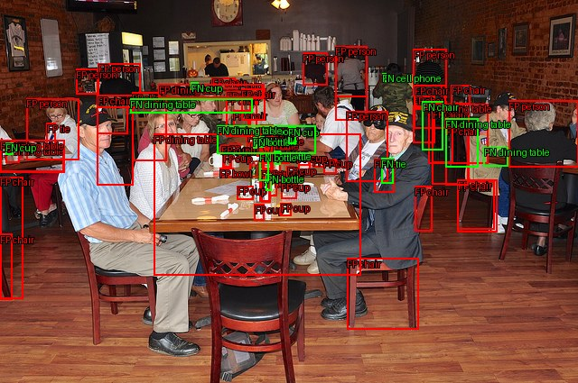
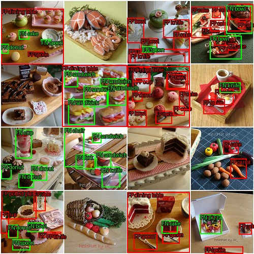
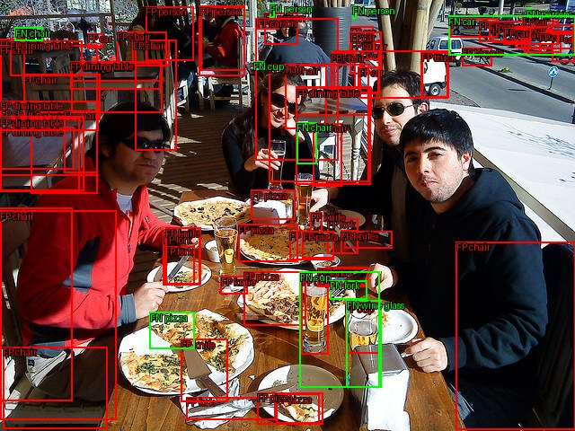

# DEIMv2-S：原生、ONNX FP32 与 TensorRT FP16

完成真实 COCO val2017 **5,000 张 / 每图300候选**的三个后端评价，mini scene-0061 六相机 **234 张**原生预测展示。完整作者 EMA checkpoint 严格加载后 deploy；骨干 DINOv3 蒸馏 ViT-Tiny + STA，192维、interaction_indexes=[3,7,11]、四层 decoder、640×640。原生始终是默认后端。

## 精度与数值检查

| 后端 | COCO AP | AP75 | APs | 相对原生 AP 下降（0–1） |
|---|---:|---:|---:|---:|
| Native FP32 | 0.50861007 | 0.55060005 | 0.31378411 | 0 |
| ONNX Runtime FP32 | 0.50860925 | 0.55060001 | 0.31378401 | 0.00000082 |
| TensorRT 10.6 FP16 | 0.50806903 | 见原始指标 | 见原始指标 | 0.00054103 |

完整指标：[native](official_eval/metrics.json)、[ONNX](onnx/official_eval/metrics.json)、[TensorRT](tensorrt/official_eval/metrics.json)。两个后端的 AP 绝对下降均小于预算0.005。0.00054103对应 **0.0541个百分点**，不是0.0541的AP绝对下降。

三者使用同一 checkpoint、原始image_id、稀疏category_id、原图xywh和完整预测，显示阈值不裁评价。原版 pycocotools COCOeval 在独立 nuscenes_eval 环境执行，防止作者 faster-coco-eval 的全局注册替换评估器；作者结果单独保存在 author_faster_coco_eval/。各后端保存 evaluator 源文件与预测哈希及 image_ids。mini没有匹配2D GT，只作展示，不报nuScenes2D AP。

- [严格加载](strict_load.json)、[模块Hook](hooks.json)、[native→deploy比较](deploy_equivalence.json)证明权重覆盖和真实网络执行。训练构造器打印“from scratch”发生在完整权重严格载入之前，不代表随机权重推理。
- 作者 ONNX 导出只改 demo batch32→1及源码导入路径，执行`--check`通过；保留 [补丁](export_batch1.patch) 和 [身份记录](export_identity.json)。虽然ONNX含动态batch标记，本次只支持/测试batch1。
- 原生 Torch2.6.0/cu124、torchvision0.21 是实际隔离兼容环境，作者2.5.1下载失败，不能称环境完全复刻。见环境freeze和下载日志。
- 最初 ORT 与 native 的 Pillow10/12 解码输入不完全一致，未作为正式对照。独立 ORT overlay 升至 Pillow12.3，并显式继承 vision 的 GPU ORT；最初错误加载CPU包的尝试触发CUDA断言，未产生推理成绩。修正后的 [预处理字节核对](preprocess_identity.json)通过，30轮配对每次核对实际输入SHA。
- TF32关闭：native显式关闭matmul/cuDNN；ORT1.16.3不支持`use_tf32` provider选项，使用进程级`NVIDIA_TF32_OVERRIDE=0`，实际provider配置见[io.json](onnx/io.json)。预热profile证明CUDA算子实际运行；图中CPU shape节点没有被当作CPU替代推理。TensorRT清除TF32 builder flag，仅FP16候选独立构建，旧8.6不变。
- ONNX score≥0.25 的72,233个框均可同类配对，最大xywh分量差0.162px、最大score差0.00423。[补充几何诊断](onnx/geometry_score025_summary.json)。完整300候选也保留诊断；低分候选变化时强制同类匹配可能产生大距离，不能解释为同一目标移动。
- TensorRT 全150万候选通过有限值、非负尺寸、类别及置信度范围检查。全图同类强制匹配出现大差值，对最差三帧再以IoU≥0.5核对：巨大差值对应IoU=0的错误配对，保留匹配的框最大分量差约0.73/0.80/1.37px。**仍有真实置信度变化**：示例车0.280→0.181、人0.113→0.320，跨越显示阈值。[逐项审计](tensorrt/worst_three_iou_audit.json)。AP通过不是逐候选严格等价，未把大差值全部归因为浮点误差或框位移。

## 30轮交错配对性能

单4090、batch1、首/中/末三张COCO图各10轮，预热后AB/BA交错，两边相同暖文件缓存；每次包含原始JPEG读取/解码/resize/normalize/H2D/forward/postprocess/D2H。JSON写入、指标评价和可视化不计入。两个实验的native基线分别测量，不能跨表行混算收益。最终TRT配对对三张图分别预热10次/后端；此前仅首图预热的试验另存为历史记录，以下使用修正后的30轮结果。

| 独立配对实验 | Native均值 / P95 ms | 候选均值 / P95 ms | 均值节省 ms | 决定 |
|---|---:|---:|---:|---|
| native ↔ ORT FP32 |17.238 /18.135|30.582 /32.924|−13.344|更慢，不采用为加速后端|
| native ↔ TRT FP16 |16.665 /17.660|7.526 /8.143|9.139|可选已测后端；默认保留native|

TensorRT该范围端到端约2.21倍加速，全部30轮更快；forward+post CUDA event均值10.919→1.827ms。原生模型与候选在配对期间同时常驻，GPU执行串行，输入逐次一致。ORT同后端三帧重复输出位级稳定。[ORT配对全数据](onnx/paired_benchmark.json)、[TRT配对全数据](tensorrt/paired_benchmark.json)。三个暖缓存样本的结果不能外推全部业务场景，也不是整条多模型感知流水线FPS。

[Native5000时序分段](profile.json)另列全序列；它不是配对优化证据。Torch allocator峰值不包含全部ORT/TRT内部内存；额外保存的设备总使用量包含其他驻留进程，采样时点为推理完成，不能当作隔离单模型精确峰值。CPU高水位包含后续预测/评价准备的内存，具体边界在各JSON内。暂未实现有CUDA event的每个ORT独立算子分段；CUDA interval包含主机调度及传输，不标为纯kernel耗时。

## 失败案例与采用决定

[原生失败统计](badcases/summary.json)在IoU0.5/score≥0.25/maxDets100-per-category口径下，TP28,294、FP37,578、FN8,041（忽略crowd/ignore匹配）。这是相对COCO标注的独立阈值诊断，不是官方AP，也不代表人工已确认所有FP都是物理误检。[逐图统计](badcases/per_image.json)保留；三张拥挤样例：

原生默认不变；ONNX为互操作/正确性验证后端，不作为提速方案；TensorRT10.6 FP16已可独立构建、运行和评价，表现出稳定提速及预算内AP下降，但其置信度变化尚不满足严格候选一致性要求，未静默替换默认回放结果。下一步若要把FP16作为默认，应对这些固定异常样本定位中间数值并独立验证混合精度策略。

## 复现与资源

见 [共同命令](../run_commands.md)、[TensorRT命令](tensorrt/reproduce.md)、[资源清单](resource_manifest.json)、[大型预测哈希](../artifact_receipt.json)。原生与后端完整预测保留本地；仓库提交全部指标、诊断、运行日志和代表性图片。原生权重SHA256为`9491ab33b68ecfc0e34043abb3009599ab1e892fb953a1faad12ef4fca5a35c4`，源码commit为`1d2ca42171570c713e78fc6a766ec5104b7f4724`。不混用作者Hub不同interaction_indexes封装。
