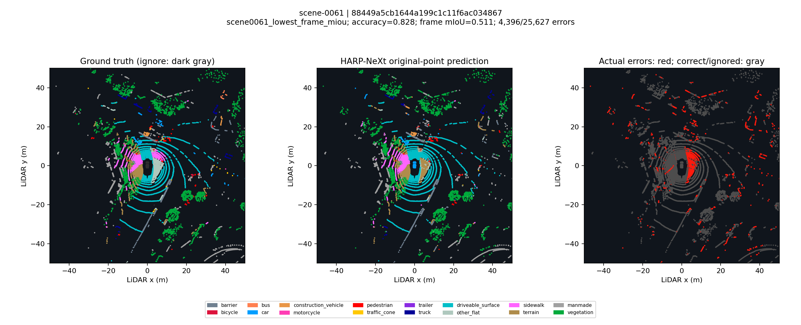
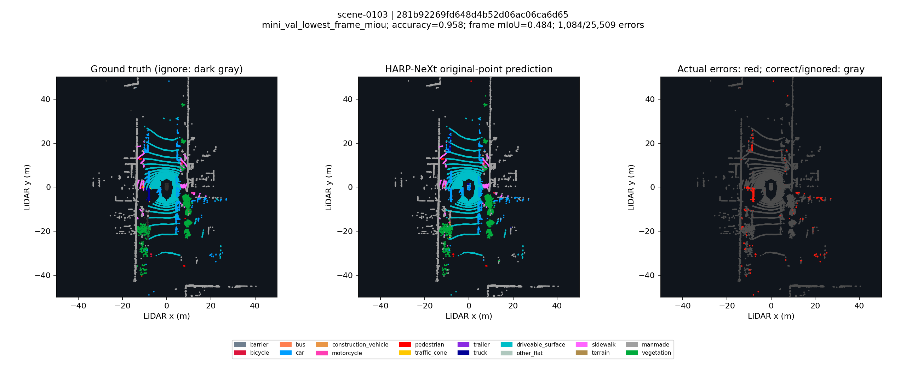
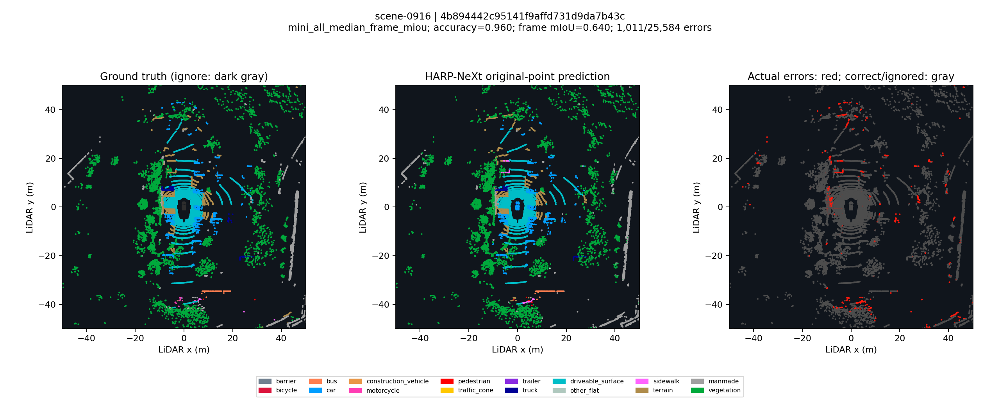

# HARP-NeXt：官方完整权重恢复后的原生 mini 推理

已使用作者完整 checkpoint 完成严格加载、首/中/末真实模块与 GT 独立验证，以及现有 nuScenes mini 全部404帧推理。状态 `completed_native_inference`。这是 mini 教学诊断，可能与预训练数据重叠，不是官方全量测试集评测。原始资源受阻报告与日志保留在恢复实验的 prior_snapshot；历史下载日志未删除。

## 配置与来源

- 官方源码固定 `532df2659700ae870c0e0d4137a4d35bcc9903b9`；调用作者 `Network("harpnext", cfg).build_network()`。
- 官方 nuScenes 32×480 配置、16类、batch1、FP32、关闭 TF32；无 TTA、无训练增强。作者 CPU 原始预处理，默认全零标签，真实 GT 在预测完成后才进入评价。
- checkpoint `ckpt_best.pth`：64,865,210字节，SHA256 `6f7fc5a1c03e9123541458358b1c703babf37ffc0b8b4ea6beac6c9f8478a147`。仅读取 `checkpoint["net"]` 并 `strict=True`，293项 state tensor，5,381,392参数，缺失/多余键均0，本文件无需去除 module 前缀。
- RTX4090、Torch2.1.2+cu118、CUDA11.8；没有升级现有环境。上游仅保留历史空 uint32 标签缓冲兼容改动，未改模型数学。`executed_source_changes.patch` 保存实际 diff，`strict_load.json` 保存全部 Python 源码、配置、适配器和差异 SHA256。

## 评价结果

仅原始点参与混淆矩阵：404帧14,026,208原始点，10,359,306有效标签点；忽略255。作者插值追加点保留在 forward 中，但全部从评价删除。网络ID0–15，展示/nuScenes粗类ID1–16。mIoU 是 union>0 类的宏平均；union=0 为 NA 并从分母排除。预测为某个 GT 缺席类别仍产生非零 union，该类别按0 IoU计入。

| 数据范围 | 帧数 | 有效点数 | mIoU | 点准确率 | mIoU分母 |
|---|---:|---:|---:|---:|---:|
| scene0061 | 39 | 1,016,188 | 0.644201 | 0.944287 | 16 |
| mini_val | 81 | 2,087,603 | 0.552162 | 0.948077 | 16 |
| mini_all | 404 | 10,359,306 | 0.773849 | 0.947851 | 16 |

逐类 intersection、union、IoU 和16×16混淆矩阵见 `metrics.json`；便于比较的表格见 `class_metrics.csv`。`mini_val`为 scene-0103/scene-0916；scene0061为39帧；mini_all为现有10个场景404帧，三者分开统计，不将39帧当作81帧验证集。

使用独立 `nuscenes_eval` 环境中未修改的 nuScenes devkit1.2.0 `nuscenes.eval.lidarseg.utils.ConfusionMatrix`，将同一16类混淆矩阵放入官方17类矩阵的1–16位置，ignore0置零，再调用官方 `get_per_class_iou`/`get_mean_iou`。三个范围逐类 IoU 差异最大值均0，mIoU仅浮点求和约1e-16差异。此为相同混淆矩阵的官方实现交叉核对，不冒充全套官方数据集评估。证据 `official_lidarseg_crosscheck.json`。

## 真实 forward 与 GT 独立性

首、中、末三帧分别记录 voxel encoder、range stem、point stem、fusion stem、所有4个ConvSENeXt、4层 point fusion 与 segmentation head 的输入/输出形状；每帧每模块6次真实调用，required zero-call为空。详见 `module_hooks.json`。

每帧依次运行 zero、zero、zero、actual、permuted、zero；permuted为真实GT固定随机排列。全部网络输入字节哈希完全相同，15个比较的原始点 argmax 预测完全相同。重复 zero 的logit最大差异分别0.000307083、0.000239372、0.000144958；actual/permuted差异处于重复基线幅度内，均满足 rtol=1e-4/atol=1e-4。CUDA聚合的数值非确定性如实记录，不误报标签泄漏；不声称逐bit logits复现。详见 `gt_prediction_independence.json`。

## 计时与内存

18次真实门控 forward 后，404帧逐帧记录同步 GPU event 与墙钟计时。下表均为实测毫秒；端到端边界包含作者 CPU processor 构造、原始文件读入、CPU预处理、输入哈希审计、H2D、模型forward、logits/预测D2H与原始点映射，不含GT评价、压缩保存或画图。它是带审计的适配器延迟，不能替代论文FPS。

| 阶段 | 均值 ms | P50 ms | P95 ms | 标准差 ms |
|---|---:|---:|---:|---:|
| preproc_ms | 141.994 | 131.854 | 181.053 | 20.356 |
| h2d_ms | 0.281 | 0.275 | 0.350 | 0.036 |
| gpu_forward_ms | 12.035 | 12.137 | 13.082 | 0.730 |
| decode_d2h_ms | 0.881 | 0.841 | 1.076 | 0.105 |
| end_to_end_ms | 155.415 | 144.945 | 194.022 | 20.412 |

冷加载0.304s；峰值 PyTorch CUDA allocated 702,427,136字节（约669.9MiB），进程峰值 RSS 1,002,340KiB。GPU峰值不包括桌面或其他进程。

历史 GPU 预处理候选仍不采用：CPU/GPU边界与index0占用语义差异记录于 `gpu_preprocessing_audit.json` 和 prior_snapshot。GPU候选并非原生推理完成的前提，本次未重跑候选。

## 实际失败例与代表图

以下每张均是同一原始点云的GT、真实模型预测、错误位置三联BEV图。仅显示±50m窗口；指标使用全部原始点，不因视窗裁剪。选择规则与主要混淆保存在 `representative_examples.json`。

### scene0061_lowest_frame_miou

样本 `88449a5cb1644a199c1c11f6ac034867`，单帧mIoU 0.5114，错误4396/25627有效点。主要混淆：other_flat→terrain 2284点；sidewalk→driveable_surface 708点；terrain→sidewalk 262点。



### mini_val_lowest_frame_miou

样本 `281b92269fd648d4b52d06ac06ca6d65`，单帧mIoU 0.4836，错误1084/25509有效点。主要混淆：truck→car 731点；driveable_surface→car 45点；car→driveable_surface 37点。



### mini_all_median_frame_miou

样本 `4b894442c95141f9affd731d9da7b43c`，单帧mIoU 0.6395，错误1011/25584有效点。主要混淆：manmade→vegetation 205点；terrain→manmade 114点；vegetation→manmade 94点。



## 产物、验证和复现

`predictions/`保存404帧完整原始点预测，附`original_index`与`processed_to_original`（追加点=-1），没有发布原始点云。`inference_frames.json`绑定 sample/sample_data token、场景、文件SHA256、原始/追加点数与每帧计时。保存后重新读取404文件，验证全部SHA256、原始索引、点数，并独立重算三个范围混淆矩阵，完全一致；见`saved_prediction_audit.json`。六项CPU针对性测试通过，包含官方缺类分母交叉核对。

```bash
perception_lab/envs/harpnext_2025/bin/python perception_lab/tools/harpnext_2025.py --phase run --config perception_lab/configs/perception_2025.yaml
perception_lab/envs/harpnext_2025/bin/python -m unittest discover -s perception_lab/tests -p test_harpnext_2025.py -v
```

运行需要本地 nuScenes mini、固定作者源码与完整权重。复现GPU运行须独占；模型权重、环境、第三方源代码、原始数据继续排除Git。统一回放由总实验单独集成，不改变这里404帧原生推理已经完成的状态。

三张图在CPU上根据已保存预测调整标题间距后重新渲染，未重新执行模型；`plot_regeneration.json`记录绘图修订后的适配器哈希，`strict_load.json`保留实际执行推理版本的哈希。
